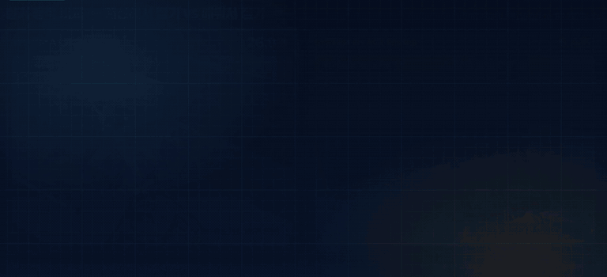
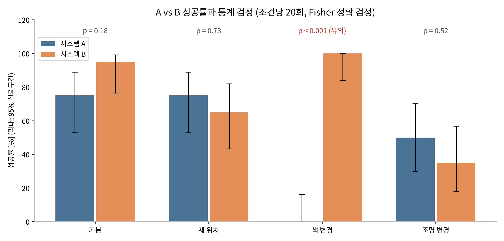
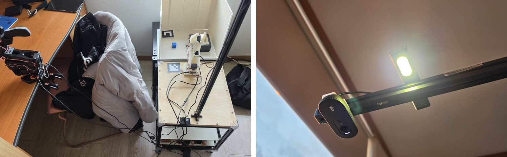
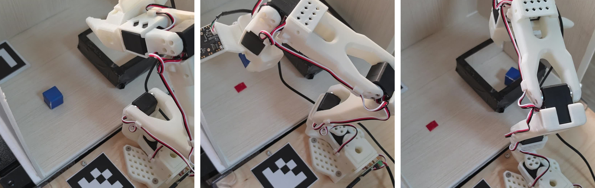
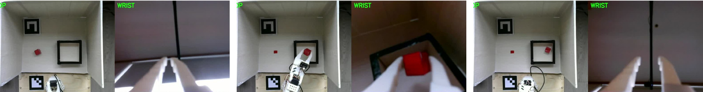
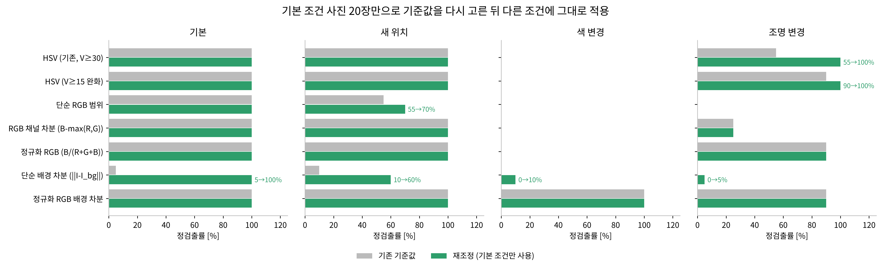
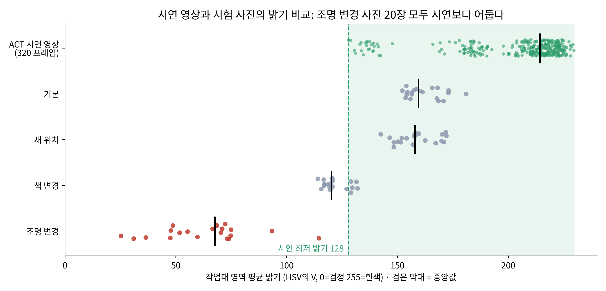
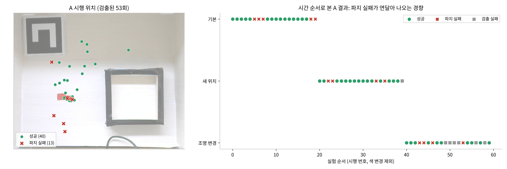

# SO-101 픽앤플레이스


SO-101 로봇팔로 25 mm 블록을 집어 상자에 넣는 작업을 **탑뷰 비전·기구학 제어(A)**와 **ACT 모방학습(B)**으로 구현했다. 실기 160회에서 A는 **40/80회(50.0%)**, B는 **59/80회(73.8%)** 성공했다.

[](https://youtu.be/sfKooGZY-iI)

**[▶ 전체 시연 보기 · YouTube · 2분 16초](https://youtu.be/sfKooGZY-iI)**

[실기 결과](#실기-160회) · [시스템 구성](#시스템-구성) · [실패 분석](#실패-분석) · [재현 가이드](docs/reproduce.md) · [최종보고서 PDF](docs/so101-final-report.pdf)

경희대학교 소프트웨어융합개론 텀프로젝트 1팀 · 김재현, 박성호

## 실기 160회

같은 팔로워암과 작업대에서 기본, 새 위치, 색 변경, 조명 변경 조건을 두 시스템으로 각각 20회씩 시험했다. 블록이 상자에 들어가면 성공으로 기록했다. A는 탑뷰 카메라 한 대, B는 탑뷰와 손목 카메라 두 대 및 관절 상태를 사용했다.

| 조건 | A · 기구학 | B · ACT |
| --- | ---: | ---: |
| 기본 | 15/20 (75%) | 19/20 (95%) |
| 새 위치 | 15/20 (75%) | 13/20 (65%) |
| 색 변경 | 0/20 (0%) | 20/20 (100%) |
| 조명 변경 | 10/20 (50%) | 7/20 (35%) |
| **전체** | **40/80 (50.0%)** | **59/80 (73.8%)** |



- **전체 격차는 색 변경에서 생겼다.** 기존 파란색 HSV 설정과 ACT 정책을 유지한 채 빨간 블록을 넣자 A는 20회 모두 검출에 실패했고, B는 20회 모두 옮겼다. 그림에는 보정 전 Fisher 검정 p값을 표시했다. 네 조건을 Holm 보정한 뒤에도 성공률 차이가 뚜렷한 조건은 색 변경이었다(p < 0.001). 두 시스템의 카메라 구성이 달라 손목 영상의 기여도는 따로 측정하지 못했다. [통계 표](analysis/tables/ab_stats.csv)
- **성공 시행의 기록 시간 중앙값은 A 26.8초, B 5.4초였다.** A는 경로 계산과 휴식 자세 복귀까지, B는 평가자가 정책을 정지할 때까지 기록했다. [시간 분포](data/report_figures/fig2_elapsed_time.png) · [시행 로그](data/experiments/trials.csv)

## 시스템 구성



### A · 탑뷰 비전과 기구학 제어

Logitech C270 영상에서 렌즈 왜곡을 보정하고, HSV 마스크로 블록의 중심과 방향을 구한다. 블록 윗면 높이(25 mm)에 맞춘 호모그래피로 로봇 베이스 좌표를 얻고, URDF 기반 해석·수치 역기구학으로 파지 자세와 이송 경로를 계산한다. 하강 후 관절을 다시 읽어 끝점 오차를 한 차례 보정한다. [검출 코드](so101/detect.py) · [호모그래피](so101/homography.py) · [역기구학](so101/ik.py) · [동작 계획](so101/pickplace.py)



### B · ACT 모방학습

리더암으로 시연 50개를 수집했다. 30 fps로 기록한 9,586프레임에는 탑뷰·손목 영상과 관절 상태, 목표 명령이 들어 있다. ACT(Action Chunking with Transformers)는 현재 관측에서 100스텝의 관절 명령을 한 묶음으로 예측한다. Seraph의 RTX 3090 한 대에서 배치 8로 100,000스텝을 학습했고, 상단 PyTorch 버전은 로컬 CPU 추론에 사용한 환경이다. [수집 스크립트](tools/record_act.sh) · [학습 설정](seraph/train_act.sbatch) · [학습 곡선](data/report_figures/fig4_act_training_loss.png) · [추론 코드](so101/act.py)



## 실패 분석

### 어두운 사진에서도 HSV 임계값을 다시 맞추면 검출이 회복됐다



조명 변경 사진에서 기존 HSV의 **픽셀 ROC AUC는 1.000**으로 반올림됐다. 픽셀 점수로 블록과 배경을 잘 가를 수 있었고, 기존 임계값을 적용했을 때 블록 중심을 맞힌 사진은 **11/20장**이었다. 기본 사진과 빈 작업대만으로 임계값을 다시 고르자 어두운 사진에서도 **20/20장**을 맞혔다. 파란색 HSV의 빨간 블록 검출은 재조정 뒤에도 **0/20장**이었다. [픽셀 ROC](analysis/figures/fig1_detector_roc.png) · [조건별 AUC](analysis/figures/fig2_detector_auc_heatmap.png)

색까지 바뀌는 조건에서는 **정규화 RGB 배경 차분**이 빨간 블록 20/20장을 포함해 **78/80장(97.5%)**으로 가장 많이 맞혔다. 평균 연산 시간은 **17.36 ms**로 기존 HSV의 **0.42 ms**보다 길었다. 이 비교는 7종 검출기를 별도 사진 80장에 적용하고, 표시한 중심에서 20 px 이내를 정검출로 집계한 결과다. [검출기별 결과](data/detector_ablation/summary.md) · [검출 마스크](data/report_figures/fig6_detector_masks.png)

### ACT의 어두운 조건 실패는 대부분 파지에서 나왔다



B의 성공률은 기본 **95%**에서 조명 변경 **35%**로 떨어졌다. 조명 변경 실패 13회 중 **12회가 파지 실패**였다. 별도로 찍은 조명 변경 사진 20장의 작업대 평균 밝기는 모두 ACT 시연 표본 320프레임의 최솟값(HSV V 128)보다 낮았다. B의 개별 시험 영상과 시작 좌표는 기록이 제한적이라 밝기나 위치가 각 실패에 얼마나 영향을 주었는지는 확인하기 어렵다. [시연 위치 분포](analysis/figures/fig3_demo_coverage.png) · [실패 유형 집계](data/experiments/summary.md)

### A는 검출한 뒤에도 파지에서 실패했다



A는 기본 조건에서 블록을 20회 모두 검출했고 그중 5회가 파지에서 실패했다. 이 시행들은 시작 위치가 거의 같았다. 전체 파지 실패 13회의 그리퍼 개도는 **0.7%**, 사람이 블록을 쥔 시연의 개도는 **9.9~14.3%**로, 실행 코드의 빈손 판정 기준인 **4%**가 두 범위 사이에 있었다. [그리퍼 개도](analysis/figures/fig5_gripper_speed.png)

A의 검출기를 정규화 RGB 배경 차분으로 교체하는 가상 분석에서는 색 변경 성공률을 **약 75%**로 추정했다. 빨간 블록의 사진 정검출률(20/20)에 나머지 조건의 검출 후 실기 성공률(40/53)을 곱한 값이다. [검출기 교체 시 추정치](analysis/figures/fig9_whatif.png) · [분석 전체](analysis/결과요약.md)

## 재현

환경을 설치한 뒤 로봇 없이 A의 집기 흐름을 확인하고, 공개한 CSV에서 성공률 표를 다시 만들 수 있다. 설치 가이드는 LeRobot 커밋 `d36f429`와 SO-101 URDF 커밋 `a758567`를 사용한다. [설치와 실기 재현 가이드](docs/reproduce.md)

```bash
python -m pytest -q tests analysis/scripts/test_detect_roc.py
python scripts/run_system_a.py blue --dry-run
python scripts/eval_compare.py summary
```

공개 자료에는 소스 코드, 카메라·모터 보정값, 시행별 실기 기록, 검출기 평가 표가 들어 있다. B를 새로 학습하거나 검출기 평가를 다시 실행하려면 가이드에 따라 시연과 검출용 사진을 수집한다. [보정값](calib/) · [실기 CSV](data/experiments/trials.csv) · [검출기 CSV](data/detector_ablation/results.csv) · [분석 표](analysis/tables/)
